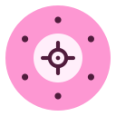
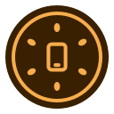
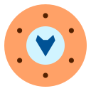
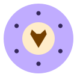

# kiwi-icons

App icons for the [Kiwi Network](https://kiwi-network.eu). Every icon is the
same kiwi cross-section, and the core carries the app's glyph. Each one comes
in three styles:

- **classic** (default): the refined GTK icon, with rim, flesh, seeds and core
- **flat**: no rim, larger core
- **night**: an inverted line mark on a dark disc

**Preview:** [derlocke-ng.github.io/kiwi-icons](https://derlocke-ng.github.io/kiwi-icons/)
(it's [`index.html`](index.html) served by GitHub Pages). It has a style and
theme switcher, a palette for each app, and buttons that copy fetch URLs.

**Builder:** [derlocke-ng.github.io/kiwi-icons/builder.html](https://derlocke-ng.github.io/kiwi-icons/builder.html)
makes a new icon in the same style: any glyph or your own icon, any color or
two, SVG or PNG download.

## Quick start

| I want to... | Do this |
|---|---|
| use an existing icon | Grab `svg/<style>/<icon>.svg` (or a PNG from `png/<style>/<size>/`), or fetch it by URL — see [Fetching an icon](#fetching-an-icon) |
| let users pick a kiwi fox color | Use the 15 ready-made [kiwi fox colorways](#kiwi-fox-colorways) |
| make an icon for a new app, or any color | Open the [builder](https://derlocke-ng.github.io/kiwi-icons/builder.html), or generate it in code with the [icon kit](#build-your-own-icon) |
| use the colors in my UI | `palette/kiwi-palette.css` / `.json` — six colors per app |
| read everything by script | `icons.json` lists every icon, its colors, URL templates, the colorways and the kit |

## Icons

| classic | flat | night | app |
|:-:|:-:|:-:|---|
|  |  |  | **kiwi updater**<br>`kiwi-updater`<br>Tool updater, installer and app browser (also kiwi apps) |
|  |  |  | **ensconce**<br>`ensconce`<br>Post-install setup for Fedora Silverblue / Bluefin |
|  |  |  | **kiwi killswitch**<br>`kiwi-killswitch`<br>Drops traffic when the VPN goes down |
|  |  |  | **kiwi server**<br>`kiwi-server`<br>Creates and manages kiwi-network meshes |
|  |  |  | **kiwi cli tools**<br>`kiwi-cli-tools-desktop`<br>Desktop helpers for the command line |
|  |  |  | **kiwi fox**<br>`kiwi-fox`<br>Anonymization suite with integrated Firefox |
|  |  |  | **kiwi pentesting**<br>`kiwi-pentesting`<br>Pentesting module for kiwi fox |
|  |  |  | **kiwi network**<br>`kiwi-network`<br>VPN mesh |
|  |  |  | **kiwiOS**<br>`kiwi-os`<br>Operating system (planned) |
|  |  |  | **kiwi app**<br>`kiwi-app`<br>Android / smartphone app |
|  |  |  | **kiwi cloud**<br>`kiwi-cloud`<br>Placeholder: cloud / sync |
|  |  |  | **kiwi backup**<br>`kiwi-backup`<br>Placeholder: backup / restore |
|  |  |  | **kiwi plugin**<br>`kiwi-plugin`<br>Placeholder: module / plugin. Used by the kiwi-proxy provider modules |
|  |  |  | **kiwi files**<br>`kiwi-files`<br>Placeholder: files / storage |
|  |  |  | **kiwi chat**<br>`kiwi-chat`<br>Placeholder: chat / messaging |
|  |  |  | **kiwi docs**<br>`kiwi-docs`<br>Placeholder: documentation / notes |
|  |  |  | **kiwi monitor**<br>`kiwi-monitor`<br>Placeholder: status / monitoring |
|  |  |  | **kiwi vault**<br>`kiwi-vault`<br>Placeholder: passwords / keys |
|  |  |  | **kiwi dns**<br>`kiwi-dns`<br>Placeholder: DNS / domains |
|  |  |  | **kiwi mail**<br>`kiwi-mail`<br>Mail service (main icon) |
|  |  |  | **kiwi mail private**<br>`kiwi-mail-private`<br>Mail: encrypted / privacy mailbox |
|  |  |  | **kiwi mail temp**<br>`kiwi-mail-temp`<br>Mail: throwaway / disposable address |
|  |  |  | **kiwi mail alias**<br>`kiwi-mail-alias`<br>Mail: aliases / forwarding |
|  |  |  | **kiwi mail send**<br>`kiwi-mail-send`<br>Mail: compose / outgoing |
|  |  |  | **kiwi mail inbox**<br>`kiwi-mail-inbox`<br>Mail: inbox / client |
|  |  |  | **kiwi proxy**<br>`kiwi-proxy`<br>Proxy / traffic relay |

## kiwi fox colorways

kiwi fox comes in 15 colorways users can choose from: eleven hues, a neutral
graphite, and three two-tones where the core and glyph carry a second color.
`ember` is the default and looks the same as `svg/<style>/kiwi-fox.svg`.

| classic | flat | night | colorway |
|:-:|:-:|:-:|---|
|  |  |  | **Ember**<br>`ember`<br>default |
|  |  |  | **Crimson**<br>`crimson` |
|  |  |  | **Rose**<br>`rose` |
|  |  |  | **Orchid**<br>`orchid` |
|  |  |  | **Violet**<br>`violet` |
|  |  |  | **Indigo**<br>`indigo` |
|  |  |  | **Ocean**<br>`ocean` |
|  |  |  | **Teal**<br>`teal` |
|  |  |  | **Forest**<br>`forest` |
|  |  |  | **Kiwi**<br>`kiwi` |
|  |  |  | **Honey**<br>`honey` |
|  |  |  | **Graphite**<br>`graphite` |
|  |  |  | **Ember + Ocean**<br>`duo-ember-ocean` |
|  |  |  | **Violet + Honey**<br>`duo-violet-honey` |
|  |  |  | **Graphite + Ember**<br>`duo-graphite-ember` |

```
colorways/kiwi-fox/<style>/<colorway>.svg
https://raw.githubusercontent.com/derlocke-ng/kiwi-icons/main/colorways/kiwi-fox/<style>/<colorway>.svg
```

[`colorways/kiwi-fox/colorways.json`](colorways/kiwi-fox/colorways.json) lists
every colorway with its label and resolved hex colors, which is all a settings
picker needs. Applying a choice is the same hicolor install as below, just with
the chosen file:

```bash
choice=ocean    # from the app's settings
install -Dm644 "colorways/kiwi-fox/classic/$choice.svg" \
    "$HOME/.local/share/icons/hicolor/scalable/apps/kiwi-fox.svg"
gtk-update-icon-cache -qtf "$HOME/.local/share/icons/hicolor" 2>/dev/null || true
```

Or generate it at runtime with the kit:
`python3 kit/kiwi_icon.py --glyph fox --colorway ocean --install kiwi-fox`.

## Build your own icon

Every icon here is the same stock kiwi base plus a glyph and a hue, so new
ones can be generated instead of drawn.

**In the browser:** the [builder](https://derlocke-ng.github.io/kiwi-icons/builder.html)
([`builder.html`](builder.html)). Pick one of the 26 glyphs or paste your own icon
(any 24×24 path, e.g. from Lucide or Tabler), a colorway or any color, an
optional second color and a style, then download SVG/PNG. It also prints the
matching CLI, Python and JS call, and the page URL reproduces the icon.

**In code:** the [icon kit](kit/README.md) in `kit/` — no dependencies.

```bash
python3 kit/kiwi_icon.py --glyph vault --colorway teal -o kiwi-vault.svg
python3 kit/kiwi_icon.py --path "M4 12h16M12 4v16" --color "#7c3aed" --style flat -o my-app.svg --png 256
python3 kit/kiwi_icon.py --list            # glyphs, styles, colorways
```

```python
from kiwi_icon import render
svg = render("fox", hue=240, accent=82, style="night")
```

```html
<script src="https://derlocke-ng.github.io/kiwi-icons/kit/kiwi-icon.js"></script>
<script>logo.innerHTML = KiwiIcon.render({ glyph: 'fox', colorway: 'teal', size: 64 });</script>
```

Colors are derived in OKLCH from one hue with fixed lightness and chroma per
role (`rim`, `flesh`, `core`, `ink`, `deep`, `text`), the same rule as the
family palette, so a generated icon sits naturally next to the official ones.
For web apps that want to recolor live, `kit/templates/<style>.svg` take their
colors from CSS variables (`--kiwi-rim`, `--kiwi-flesh`, ...). Details and all
options: [kit/README.md](kit/README.md).

## Layout

| Path | What |
|---|---|
| `svg/<style>/<icon>.svg` | The source icons (128×128 viewBox). These are the masters. |
| `png/<style>/<size>/<icon>.png` | Renders at 16, 32, 48, 64, 128, 256 and 512 px |
| `icons.json` | Machine-readable index: icon ids, wordmarks, descriptions, colors, URL templates |
| `palette/kiwi-palette.{css,json}` | Six colors per app: `rim`, `flesh`, `core`, `ink`, `deep`, `text` |
| `design/` | The original design sheet (`kiwi-logo-sheet.png`) and the standalone design page |
| `tools/render-png.sh` | Rebuilds `png/` from `svg/` |
| `colorways/kiwi-fox/<style>/<colorway>.svg` | kiwi fox in 15 colorways, plus `colorways.json` |
| `kit/` | Icon kit: `kiwi_icon.py`, `kiwi-icon.js`, CSS-variable `templates/`, `glyphs.json`, `colorways.json` |
| `builder.html` | The icon builder (GitHub Pages) |
| `tools/build-kit.py` | Regenerates `colorways/` and the kit's data files from `kit/kiwi_icon.py`, and checks the JS kit matches |

## Using an icon in a Kiwi app

Every Kiwi app ships its own copy: the classic SVG, byte for byte, at a
repo-relative path named by `ICON=` in its `kiwi.manifest`:

```bash
cp svg/classic/kiwi-fox.svg ../kiwi-fox/data/kiwi-fox.svg
# and in kiwi-fox/kiwi.manifest:
ICON=data/kiwi-fox.svg
```

kiwi-updater (2.2 and later) draws that file in its list, cards and detail
view, read from the app's own clone — nothing is fetched at install time.
Keeping the copy byte-identical to the master makes drift a one-line `cmp`.

An app whose `.desktop` launcher names its own icon (`Icon=kiwi-fox`) also
installs that SVG into the hicolor theme and rebuilds the icon cache, so an
updated icon replaces the old one in the app grid:

```bash
dest="${KIWI_PREFIX:-$HOME/.local}/share/icons/hicolor"   # system scope: /usr/share/icons/hicolor
install -Dm644 data/kiwi-fox.svg "$dest/scalable/apps/kiwi-fox.svg"
gtk-update-icon-cache -qtf "$dest" 2>/dev/null || true
```

The kiwi-proxy provider modules (`kiwi-plugin-tor`, `-vpn`, `-9proxy`, `-myst`)
share the `kiwi-plugin` icon and ship it as `data/kiwi-plugin.svg`.

## Fetching an icon

For anything that does not ship its own copy, fetch the icon from here. The
URL pattern is:

```
https://raw.githubusercontent.com/derlocke-ng/kiwi-icons/main/svg/<style>/<icon>.svg
https://raw.githubusercontent.com/derlocke-ng/kiwi-icons/main/png/<style>/<size>/<icon>.png
```

For example, an `install.sh` can install the icon into the hicolor theme
under the app's id:

```bash
ICON=kiwi-fox
ICONS_URL=https://raw.githubusercontent.com/derlocke-ng/kiwi-icons/main

dest="$HOME/.local/share/icons/hicolor"   # system scope: /usr/share/icons/hicolor
mkdir -p "$dest/scalable/apps"
curl -fsSL "$ICONS_URL/svg/classic/$ICON.svg" -o "$dest/scalable/apps/$ICON.svg"
for size in 16 32 48 64 128 256 512; do      # for desktops that want bitmaps
    mkdir -p "$dest/${size}x${size}/apps"
    curl -fsSL "$ICONS_URL/png/classic/$size/$ICON.png" -o "$dest/${size}x${size}/apps/$ICON.png"
done
gtk-update-icon-cache -q -t "$dest" 2>/dev/null || true
```

Then `Icon=kiwi-fox` in the app's `.desktop` file finds it.

An installer that must work offline should not depend on this fetch — ship a
copy as above, or fall back to a generic icon when `curl` fails. To protect
against future redesigns, swap `main` in the URL for a release tag.

## Changing or adding an icon

1. Edit or add `svg/<style>/<icon>.svg`, in all three styles.
2. Add the app's colors to `palette/kiwi-palette.json` and `.css`, and an
   entry to `icons.json`.
3. Run `tools/render-png.sh` (needs `rsvg-convert` from `librsvg2-tools`)
   and commit the regenerated `png/`.
   If you added or changed a glyph or app hue, add it to `GLYPHS` / `APP_HUES`
   in both `kit/kiwi_icon.py` and `kit/kiwi-icon.js`, then run
   `python3 tools/build-kit.py`.
4. Copy the new classic master into every app that ships it (the file its
   `ICON=` names; for `kiwi-plugin`, all four provider modules), so the apps
   pick up the change.

The SVGs were exported from Claude and carry C2PA content credentials in
their `<metadata>`, which account for most of each file's size. The PNG
renders do not include them. Colorways and anything the kit or builder
generates are plain SVG without that metadata.
